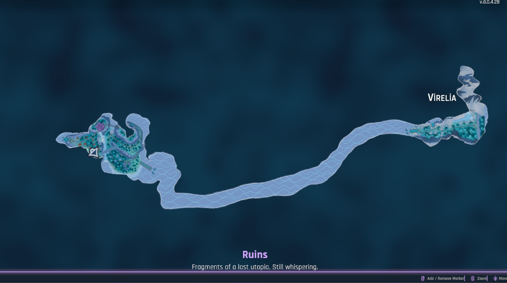
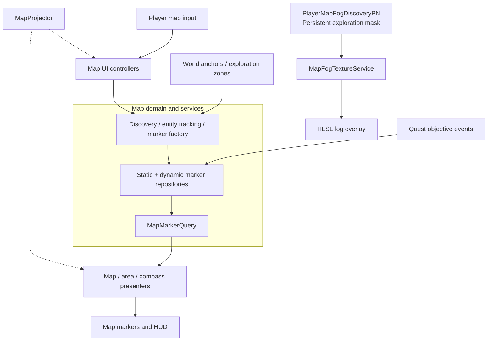
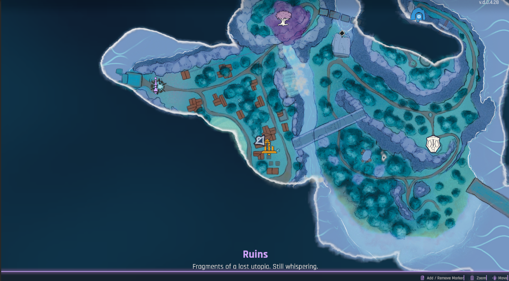
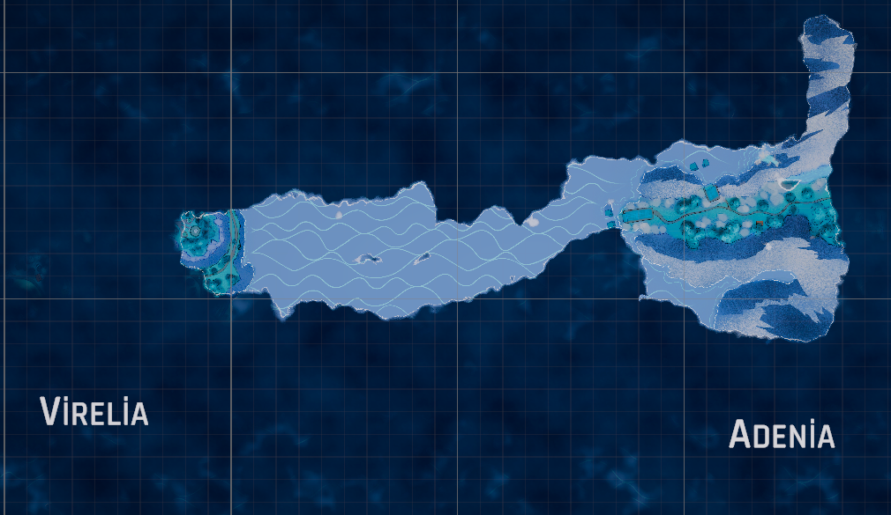

# Unity Map System

**A world map and exploration system for Unity, developed for Elysium.**

The system brings together a navigable world map, persistent exploration, fog of war, points of interest, quest objectives, and player-placed markers. It separates map data and gameplay state from the UI, so the same marker information can drive map views, detail panels, and the compass.

This repository contains the map system extracted from a larger game project. It is shared as a **source-code and architecture showcase**, rather than a standalone Unity package.

## Map overview

The full-screen map supports panning, zooming, player centering, and viewing the discovered parts of the world. Locations and markers stay aligned with their world-space positions as the map is navigated.

<p align="center">
  
</p>

## Architecture at a glance



`MapSystemContext` initializes and exposes the core services. Marker repositories hold state, presenters translate that state into views, and the fog-of-war path manages its own exploration mask. The diagram shows responsibilities, not a strict frame-by-frame call order.

**[Explore the class diagrams, data flows, and networking boundaries →](architecture.md)**

## Markers and navigation

The map supports several marker categories: **points of interest, players and teammates, quest objectives, area objectives, and player-placed pins**. Markers can have different visibility and tracking states, while their visuals and detail panels depend on their type.

<p align="center">
  
</p>

- **Discoverable locations:** Points of interest become visible when the player discovers their associated world locations.
- **Quest markers:** Active quest objectives appear on the map and compass; objectives can also highlight an area rather than just a point.
- **Player-placed pins:** Custom markers can be placed and removed on the map, with support for local or shared markers.
- **Entity tracking:** Player, teammate, and other entity markers can update their positions and facing directions.
- **Contextual UI:** Hover, selection, tooltips, marker details, and marker scaling respond to map interactions and zoom.
- **Compass integration:** Tracked and relevant markers can also be represented outside the full-screen map.

## Fog of war and exploration

Exploration is tracked separately from the marker system. As the player moves through the world, nearby parts of a persistent discovery mask are revealed. An HLSL UI shader uses that mask to render the unexplored regions with softened, irregular edges.

<p align="center">
  
</p>

The system includes:

- **Progressive discovery** based on player movement and a configurable reveal radius.
- **Persistent exploration** with encoded discovery masks that can be restored from save data.
- **Efficient mask updates** that upload the changed texture region when supported, instead of re-uploading the whole mask for every reveal.
- **Shader-based presentation** with configurable fog colors, feathering, edge distortion, and noise.
- **Multiplayer synchronization** using server-side discovery state, owner-targeted snapshots, and incremental updates.

## Key systems

### Map data and projection

`MapSystemContext` constructs the marker repositories, query and gameplay services, and exposes an `IMapProjector`. `MapProjector` converts between world positions and the map's local or normalized coordinates so markers, selection, and player centering use a consistent projection.

### Discovery and world locations

Static POIs are registered through world anchors. `DiscoveryService` changes their visibility when discovery zones are entered. Island-level **discovered** and **revealed** states are managed separately by `IslandRepository`, allowing a location to be known without treating every reveal interaction as the same event.

### Objectives and markers

`QuestMapMarkerService` listens to quest progress, registers active objective markers, and removes them as objectives finish. Dynamic and static marker repositories publish changes that presenters use to update the map and compass without embedding game logic in UI prefabs.

### UI and interaction

`MapInputHandler`, `MapViewController`, and `MapInteractionController` handle input, map navigation, hit testing, and marker interaction. Presenter components create and refresh the visual marker layers, keeping display code separate from marker state.

### Persistence and networking

Exploration masks, island discovery, and player-placed markers each have their own save representation. Optional shared pins are handled by `MapNetworkMarkerService` through server-authoritative create/remove requests; ordinary local markers do not require that replication path.

## Design principles

- **Separation of concerns:** gameplay state, marker storage, rendering, and interaction have distinct responsibilities.
- **Event-driven UI:** marker changes and discovery events update the relevant presenters.
- **World-space consistency:** marker positioning and map interaction share a projection abstraction.
- **Persistent exploration:** discovery is gameplay state, not just a temporary visual effect.
- **Multiplayer-aware boundaries:** local presentation is kept separate from server-managed shared state.

## Repository structure

```text
Assets/MapSystem/
├── Scripts/
│   ├── Core/
│   │   ├── Context/        # Service composition and fog discovery state
│   │   ├── Definitions/    # World, island, and POI definitions
│   │   ├── Markers/        # Marker domain models
│   │   ├── Repositories/   # Marker, island, and save state
│   │   └── Services/       # Discovery, quest markers, tracking, and fog
│   ├── Network/            # Shared marker replication
│   ├── Presenters/         # Marker, area, detail, and compass presentation
│   ├── UI/                 # Map input, navigation, panels, and marker views
│   └── World/              # World anchors and discovery interactions
└── Visuals/Fog/            # HLSL fog-of-war shaders
```

## Integration notes

The code was developed as part of **Elysium**, with dependencies on the host game's player, quest, save, localization, and interaction systems. Some components also rely on **Unity Netcode for GameObjects**, **Unity Input System**, **URP**, and **Odin Inspector**. The repository is not intended to run independently without those integrations.

For component responsibilities, class relationships, discovery flows, and fog/network details, see **[architecture.md](architecture.md)**.
