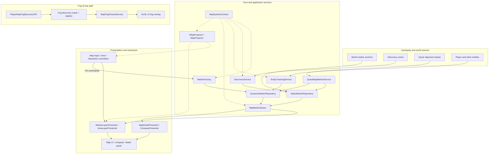
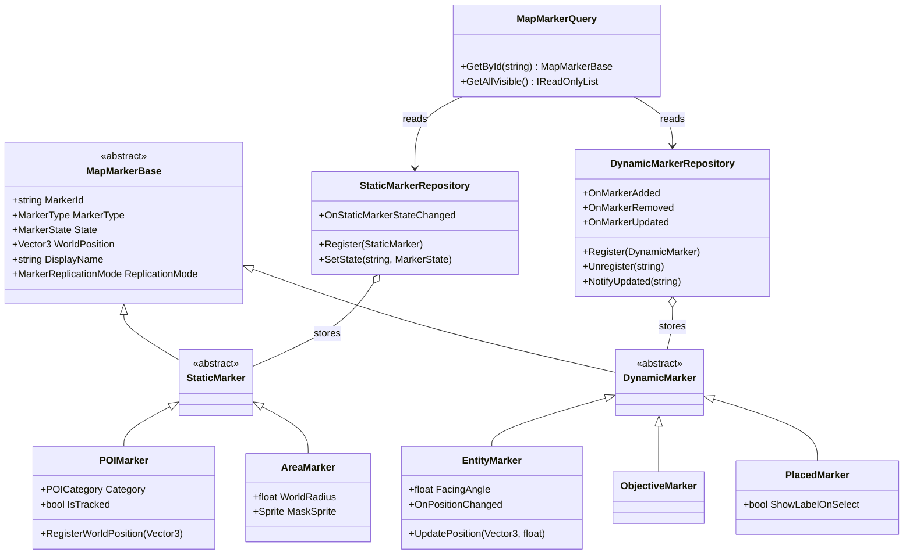
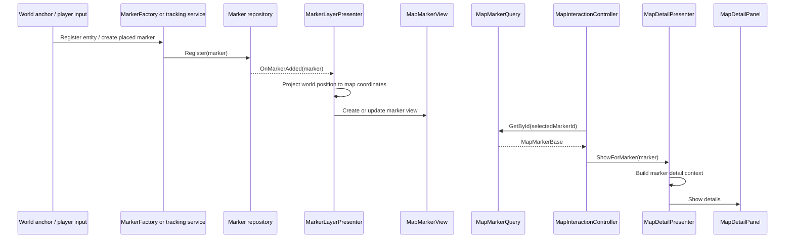
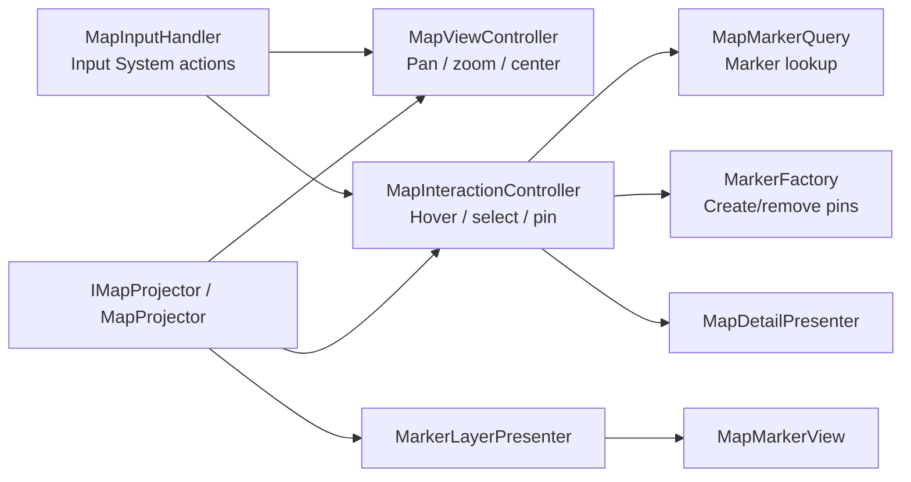
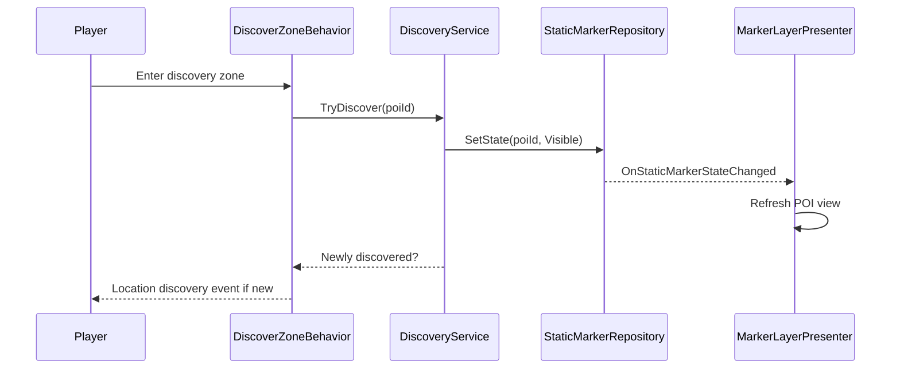
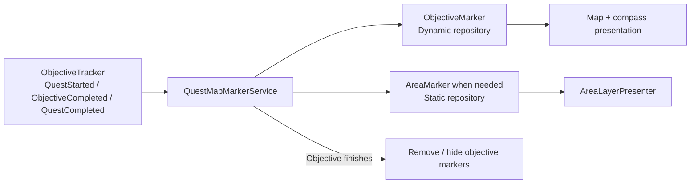
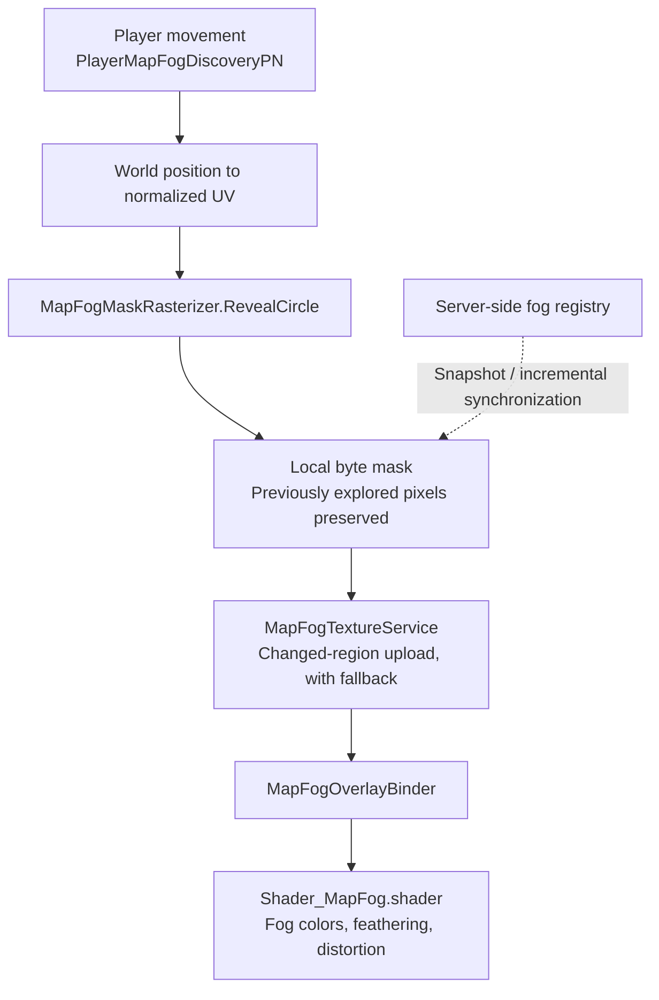
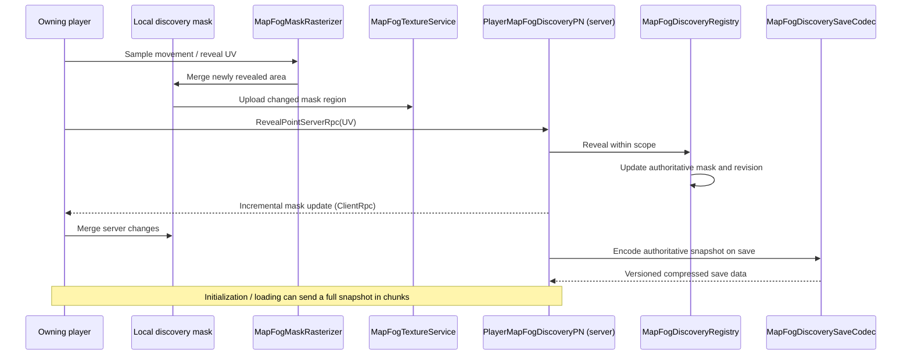
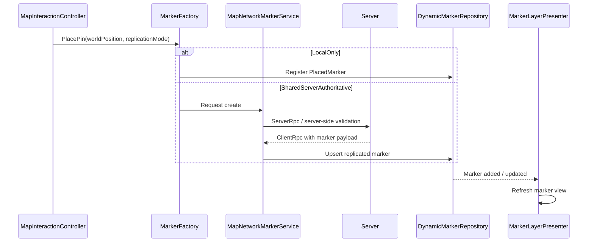
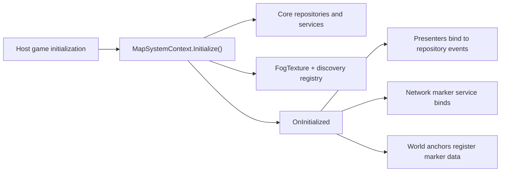

# Unity Map System — Architecture

This document describes the main runtime architecture of the map system extracted from **Elysium**. The system separates **world data and gameplay state** from **map presentation and interaction**, while fog of war and optional multiplayer marker replication have their own update paths.

The diagrams use the classes currently present in the repository. An arrow may represent a dependency, an event subscription, or a logical data flow; it does not imply that every connected component calls the next one directly.

## 1. Architectural layers

### 1.1 System overview

The placement of `MapSystemContext` is intentional: it **creates and exposes services** but does not own every MonoBehaviour in the scene. World anchors, UI components, quest integrations, and networked components attach through the initialized context or their own lifecycle.

### 1.2 Responsibilities by layer

| Layer | Responsibility | Main components |
| --- | --- | --- |
| **Composition** | Construct core services and expose shared references | `MapSystemContext` |
| **Domain** | Represent marker identity, type, state, and position | `MapMarkerBase` and subclasses |
| **Repositories** | Store marker collections and notify listeners | `StaticMarkerRepository`, `DynamicMarkerRepository` |
| **Gameplay services** | Create markers, track entities, discover locations, bridge quest state | `MarkerFactory`, `EntityTrackingService`, `DiscoveryService`, `QuestMapMarkerService` |
| **Projection** | Convert between world, normalized, and UI-map coordinates | `IMapProjector`, `MapProjector` |
| **Presentation** | Convert state changes into map, details, and compass visuals | `MarkerLayerPresenter`, `AreaLayerPresenter`, `MapDetailPresenter`, `CompassPresenter` |
| **Interaction** | Route player actions to pan/zoom, selection, and marker commands | `MapInputHandler`, `MapViewController`, `MapInteractionController` |
| **Fog** | Store and visualize exploration progress | `PlayerMapFogDiscoveryPN`, `MapFogDiscoveryRegistry`, `MapFogTextureService` |
| **Networking / saves** | Replicate selected state and persist progress | `MapNetworkMarkerService`, `MapSaveHandler`, `IslandRepository`, fog save codec |

## 2. Marker domain model

Markers are **plain data objects**, not UI GameObjects. Each has an ID, marker type, visibility/tracking state, world position, and optional display metadata. Presentation is handled elsewhere.

**Static** and **dynamic** describe how marker data is managed; they do not mean that a static marker can never change state. For example, a POI changes from `Hidden` to `Visible` when discovered. An entity marker can change position continuously and raises `OnPositionChanged` for its views.

`MarkerState` includes `Hidden`, `Visible`, `Active`, `Tracked`, `Cleared`, and `Disabled`. `MarkerType` distinguishes POIs, players, teammates, pins, quest targets, and area markers. Marker type and state are different concerns: a **quest objective** is a type; **tracked** is a state.

## 3. Marker lifecycle and UI propagation

### 3.1 Creating and displaying a marker

This sequence illustrates two common paths together. Static POIs are **registered by their anchors directly into the static repository**; player pins normally go through `MarkerFactory`; moving entities go through `EntityTrackingService`.

`MarkerLayerPresenter` subscribes to repository add/remove/update events and maintains a dictionary of views keyed by marker ID. For `EntityMarker`, it also listens for position updates. `AreaLayerPresenter` has a separate view path for area markers. `CompassPresenter` consumes marker changes to rebuild its entries.

### 3.2 Input and projection

`MapProjector` is the canonical projection abstraction for marker positioning, pointer-to-world conversions, and player centering in the map UI. Its interface keeps world-space conversion separate from individual presenters and controllers. Fog sampling uses normalized UVs derived from world bounds in its own discovery path (see section 5).

## 4. Discovering locations and tracking quests

### 4.1 Point-of-interest and island discovery

POI discovery and island discovery are **separate mechanisms**:

- `MapStaticMarkerAnchor` registers a `POIMarker` from a `MapPOIDefinition`.
- `DiscoverZoneBehavior` asks `DiscoveryService` to reveal a previously hidden POI.
- `IslandDiscoverZoneBehavior` marks an island as **discovered** through `IslandRepository`.
- `MapIslandRevealer` can mark an island as **revealed** following its own interaction.
- `IslandRepository` stores the two island states independently and refreshes the relevant island UI.

These states are not the same as the fog mask: finding a POI, revealing an island, and clearing unexplored fog represent distinct gameplay changes.

### 4.2 Quest objectives

`QuestMapMarkerService` also hydrates markers for already-active quests. Each eligible objective gets a point marker, and objectives configured with an area add an area overlay. Completing an objective removes its marker(s); completing the quest cleans up remaining objective markers. The quest system remains the source of truth for objective progress.

## 5. Fog-of-war architecture

The fog system stores **persistent discovery intensity** in a CPU-side byte mask. Gameplay updates that mask; presentation uploads it as a texture and feeds an HLSL UI shader. The shader controls colors and edges but does **not** determine what is saved as discovered.

### 5.1 Data and rendering path

`MapFogMaskRasterizer` reveals a circle around the player's sampled position. New reveal values are combined using the maximum of the old and new values, so exploration does not disappear as the player walks away. The rasterizer reports a changed rectangle, which `MapFogTextureService` can upload through a staging texture and `Graphics.CopyTexture`. Unsupported or unsuitable cases fall back to a full upload.

`MapFogOverlayBinder` attaches the runtime fog material to a UI `Graphic`. The URP HLSL shader consumes `_FogMask` and renders the visual fog with adjustable feathering, edge noise, and domain distortion. The **CPU mask remains the saved state**, not the rendered pixels.

### 5.2 Multiplayer synchronization and save flow

The owner gets a **local reveal immediately**, then sends the location to the server. The server stores the authoritative discovery state in `MapFogDiscoveryRegistry`; incremental owner-targeted updates and full chunked snapshots help reconcile the local mask. `MapFogMaskCodec` provides mask encoding/decoding and integrity validation; `MapFogDiscoverySaveCodec` wraps encoded data with version and scope metadata for the save system.

The scope model supports `Player`, `Party`, `Team`, and `World` keys; the player component defaults to a **player scope**. Which scopes are actually used depends on the host game's setup.

## 6. Multiplayer markers and persistence

**Shared map pins are separate from fog synchronization.** `MarkerFactory` creates markers locally by default. When a marker requests `SharedServerAuthoritative` replication, it forwards creation/removal to `MapNetworkMarkerService`, which validates allowed marker types and broadcasts the result. The current service defaults to allowing shared `Pin` markers.

The following persistence paths remain independent:

| Saved data | Responsible component | Main contents |
| --- | --- | --- |
| Discovered POIs and placed pins | `MapSaveHandler` | Discovered marker IDs, placed-marker data and replication mode |
| Island progress | `IslandRepository` | Discovered and revealed island IDs |
| Fog of war | `PlayerMapFogDiscoveryPN` + `MapFogDiscoverySaveCodec` | Encoded discovery mask with resolution and scope metadata |

This separation avoids making marker repositories responsible for exploration texture data, or making the fog renderer responsible for game saves.

## 7. Initialization and integration boundaries

`MapSystemContext.Initialize()` constructs the static and dynamic repositories, marker query, discovery service, entity tracking service, marker factory, fog registry, and map projector. It initializes `MapFogTextureService` and notifies components through `OnInitialized`. Presenters and network services bind when the context is ready and detach on shutdown.

The map repository is a **source showcase from a larger Unity game**, not a self-contained example scene. It refers to host-game services such as the quest tracker, save manager, input bootstrap, world interaction events, and player network lifecycle. Relevant external integrations include Unity Netcode for GameObjects, Unity Input System, URP, and Odin Inspector.

### Source code guide

| Area | Relevant source files |
| --- | --- |
| Composition | [`MapSystemContext.cs`](https://github.com/enesovski/unity-map-system/blob/main/Assets/MapSystem/Scripts/Core/Context/MapSystemContext.cs) |
| Marker models | [`Core/Markers/`](https://github.com/enesovski/unity-map-system/tree/main/Assets/MapSystem/Scripts/Core/Markers) |
| Repositories | [`Core/Repositories/`](https://github.com/enesovski/unity-map-system/tree/main/Assets/MapSystem/Scripts/Core/Repositories) |
| Discovery | [`DiscoveryService.cs`](https://github.com/enesovski/unity-map-system/blob/main/Assets/MapSystem/Scripts/Core/Services/DiscoveryService.cs), [`DiscoverZoneBehavior.cs`](https://github.com/enesovski/unity-map-system/blob/main/Assets/MapSystem/Scripts/World/DiscoverZoneBehavior.cs) |
| Quest integration | [`QuestMapMarkerService.cs`](https://github.com/enesovski/unity-map-system/blob/main/Assets/MapSystem/Scripts/Core/Services/QuestMapMarkerService.cs) |
| Projection | [`MapProjector.cs`](https://github.com/enesovski/unity-map-system/blob/main/Assets/MapSystem/Scripts/Core/Grid/MapProjector.cs) |
| Map UI | [`MarkerLayerPresenter.cs`](https://github.com/enesovski/unity-map-system/blob/main/Assets/MapSystem/Scripts/Presenters/MarkerLayerPresenter.cs), [`MapViewController.cs`](https://github.com/enesovski/unity-map-system/blob/main/Assets/MapSystem/Scripts/UI/Controls/MapViewController.cs) |
| Fog state and rendering | [`PlayerMapFogDiscoveryPN.cs`](https://github.com/enesovski/unity-map-system/blob/main/Assets/MapSystem/Scripts/World/PlayerMapFogDiscoveryPN.cs), [`MapFogMaskRasterizer.cs`](https://github.com/enesovski/unity-map-system/blob/main/Assets/MapSystem/Scripts/Core/Services/MapFogMaskRasterizer.cs), [`MapFogTextureService.cs`](https://github.com/enesovski/unity-map-system/blob/main/Assets/MapSystem/Scripts/Core/Services/MapFogTextureService.cs) |
| Shared markers | [`MapNetworkMarkerService.cs`](https://github.com/enesovski/unity-map-system/blob/main/Assets/MapSystem/Scripts/Network/MapNetworkMarkerService.cs) |

---

For a visual walkthrough and the main features, return to the **[README](README.md)**.
